<p align="center">
  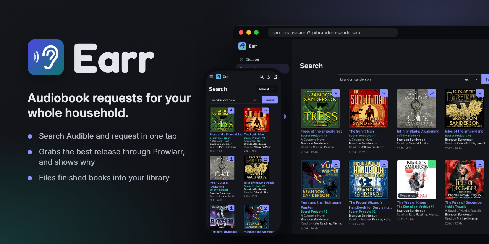
</p>

<p align="center">
  <a href="https://github.com/JediBrooker/Earr/actions/workflows/build.yaml"></a>
  <a href="https://github.com/JediBrooker/Earr/pkgs/container/earr"></a>
  <a href="LICENSE"></a>
</p>

Earr is a request app for audiobooks, in the spirit of Overseerr and Jellyseerr. Everyone in your household
searches Audible's catalogue and requests what they want to hear. Earr finds a release through Prowlarr, hands it to
your download client, and files the finished book into your library for Audiobookshelf, Plex or Jellyfin to pick up.

It is a fork of [AudioBookRequest](https://github.com/markbeep/AudioBookRequest) by Markbeep. This fork adds:

- **Library organizing:** finished downloads are hardlinked, copied or moved into a folder structure you choose, with a
  `metadata.json` that Audiobookshelf reads.
- **Download tracking:** each request shows whether it was grabbed, landed in the library or failed, instead of
  "downloaded" the moment it was sent to the client.
- **qBittorrent and SABnzbd integration:** Earr asks the client where a grab ended up and can move it into a category.
- **A stricter quality bar:** nothing is downloaded automatically unless it passes your settings, and the Sources page
  shows why each release passes or fails.
- **Retries:** requests that haven't produced files are searched for again on a schedule.
- **Activity page:** live progress, speed and time left for every download, its history, and a manual import for
  downloads Earr couldn't match by itself.
- **Approvals:** approve or decline requests from untrusted users, with the reason sent through your notifications.
- **System page:** checks Prowlarr, the download clients, Audiobookshelf and your folders, with a health light in the
  sidebar.
- **Library page:** browse what's already in your Audiobookshelf library.
- **Faster Audiobookshelf hand-off:** a new book is added by scanning just its folder, and empty metadata is filled in.
- **Clearer search results:** cards show the series, narrators, year and length, and whether a book is already
  requested, downloading or in the library.
- **Following authors and series:** new books are requested automatically as soon as Audible lists them.
- **Pre-orders and a calendar:** request a book before it's out, and it's searched for on its release day.
- **Book pages:** the description, the whole series in reading order with what you have, and more by the author.
- **Blocklist:** a release that failed or was removed is never grabbed again, and the next best one is tried.
- **Languages:** releases in a language you don't want are never downloaded automatically.
- **Transmission, Deluge and NZBGet**, alongside qBittorrent and SABnzbd.
- **Request limits** per group or per person, and **sign in with Audiobookshelf** accounts.
- **Backups and logs** on the System page.
- A Sonarr-style layout, a test suite, and images published to GitHub Container Registry on every push.

## Screenshots

<table>
  <tr>
    <td width="50%">
      <picture>
        <source media="(prefers-color-scheme: dark)" srcset="media/screenshots/home-dark.png">
        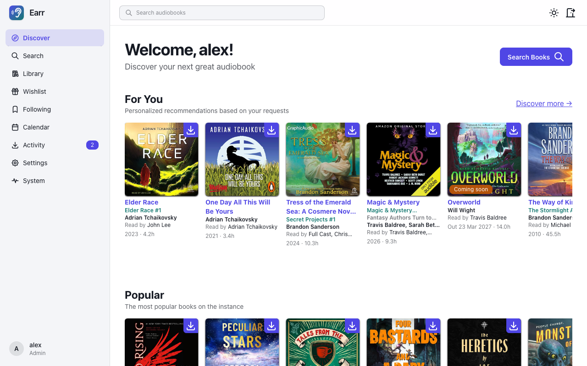
      </picture>
      <p align="center"><b>Discover</b>: recommendations and what's trending</p>
    </td>
    <td width="50%">
      <picture>
        <source media="(prefers-color-scheme: dark)" srcset="media/screenshots/search-dark.png">
        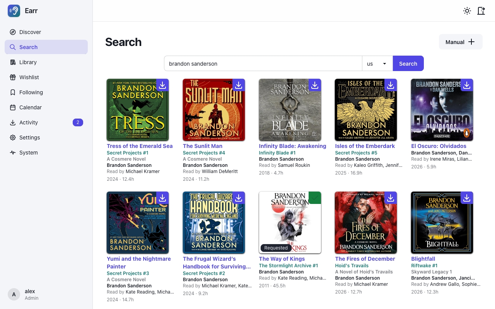
      </picture>
      <p align="center"><b>Search</b>: request with one click</p>
    </td>
  </tr>
  <tr>
    <td width="50%">
      <picture>
        <source media="(prefers-color-scheme: dark)" srcset="media/screenshots/wishlist-dark.png">
        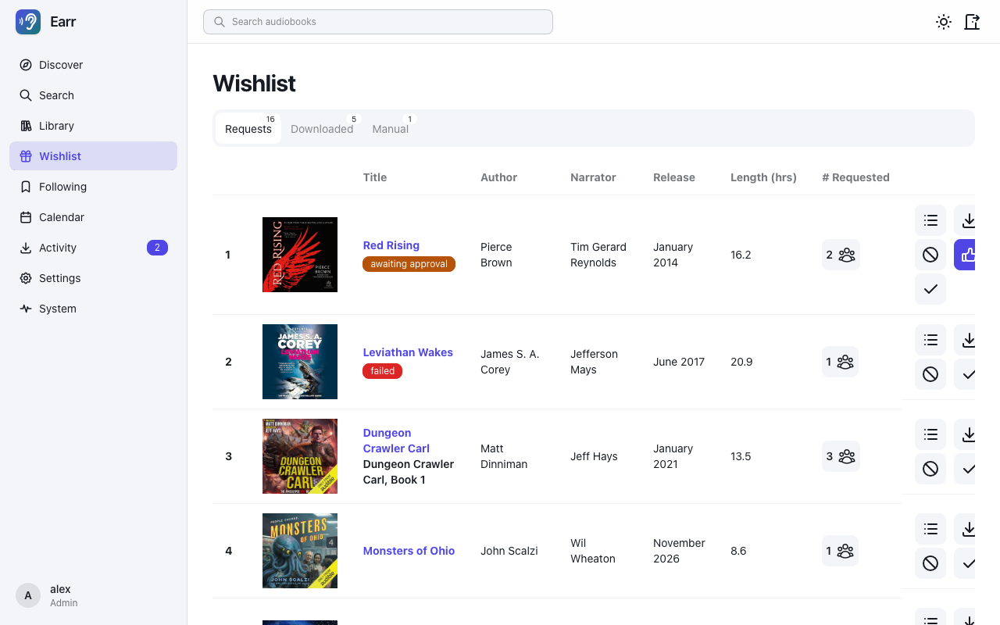
      </picture>
      <p align="center"><b>Wishlist</b>: every request and where it's at</p>
    </td>
    <td width="50%">
      <picture>
        <source media="(prefers-color-scheme: dark)" srcset="media/screenshots/sources-dark.png">
        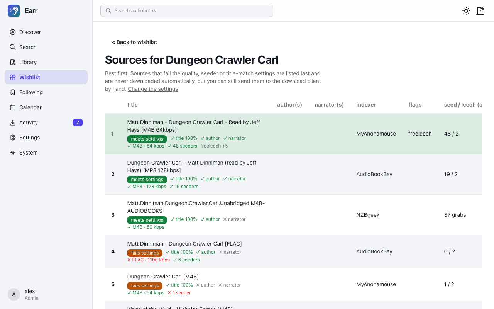
      </picture>
      <p align="center"><b>Sources</b>: ranked releases, and why each passes or fails</p>
    </td>
  </tr>
  <tr>
    <td width="50%">
      <picture>
        <source media="(prefers-color-scheme: dark)" srcset="media/screenshots/book-dark.png">
        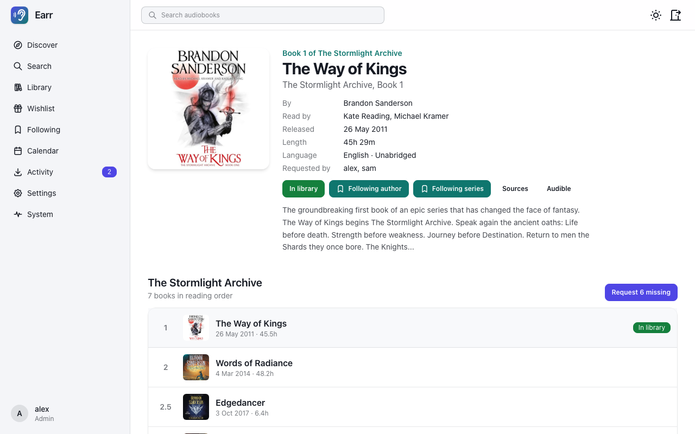
      </picture>
      <p align="center"><b>Book</b>: the series in order, and what you have of it</p>
    </td>
    <td width="50%">
      <picture>
        <source media="(prefers-color-scheme: dark)" srcset="media/screenshots/following-dark.png">
        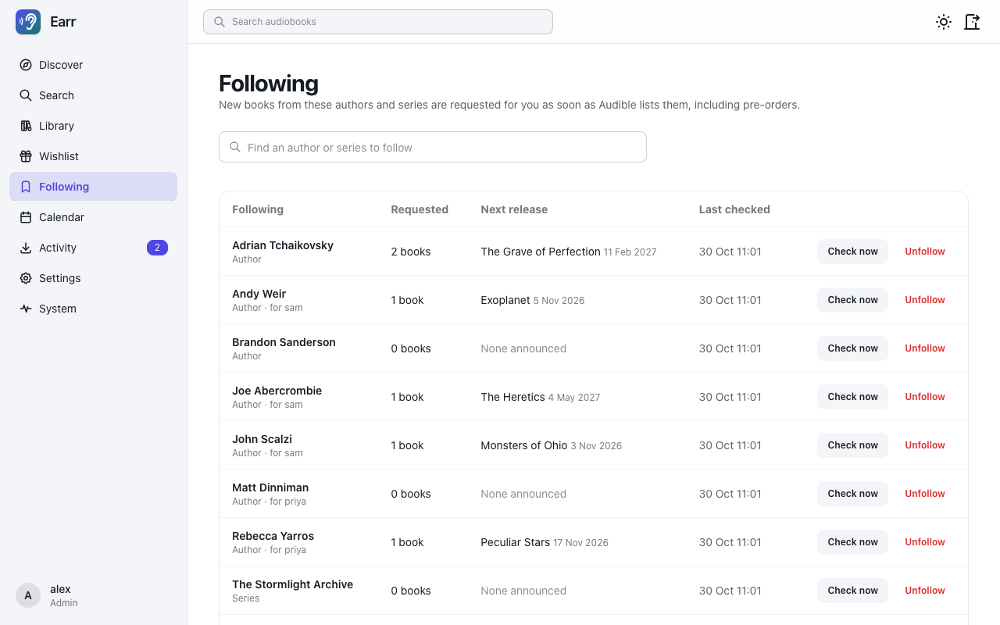
      </picture>
      <p align="center"><b>Following</b>: new books requested as soon as they're listed</p>
    </td>
  </tr>
  <tr>
    <td width="50%">
      <picture>
        <source media="(prefers-color-scheme: dark)" srcset="media/screenshots/calendar-dark.png">
        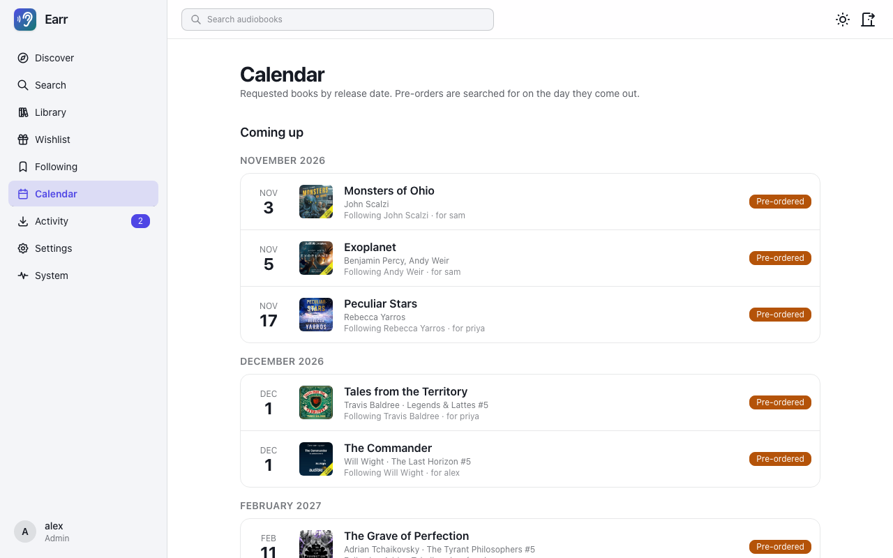
      </picture>
      <p align="center"><b>Calendar</b>: pre-orders and what just came out</p>
    </td>
    <td width="50%">
      <picture>
        <source media="(prefers-color-scheme: dark)" srcset="media/screenshots/activity-dark.png">
        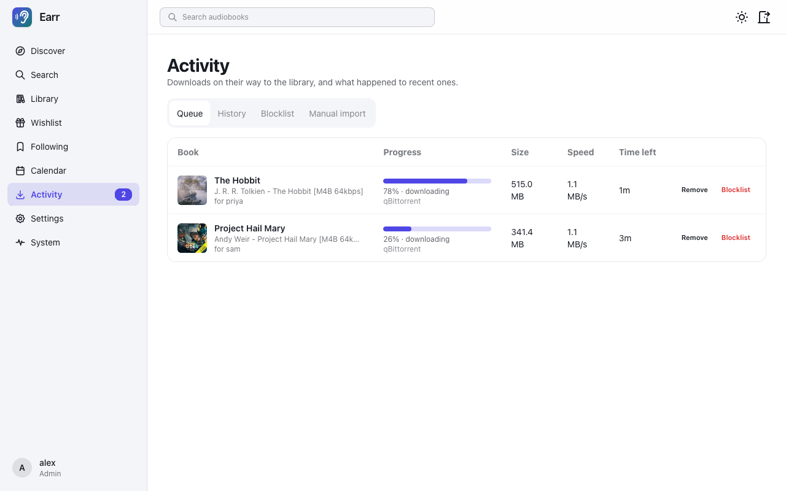
      </picture>
      <p align="center"><b>Activity</b>: downloads on their way, with live progress</p>
    </td>
  </tr>
  <tr>
    <td width="50%">
      <picture>
        <source media="(prefers-color-scheme: dark)" srcset="media/screenshots/books-dark.png">
        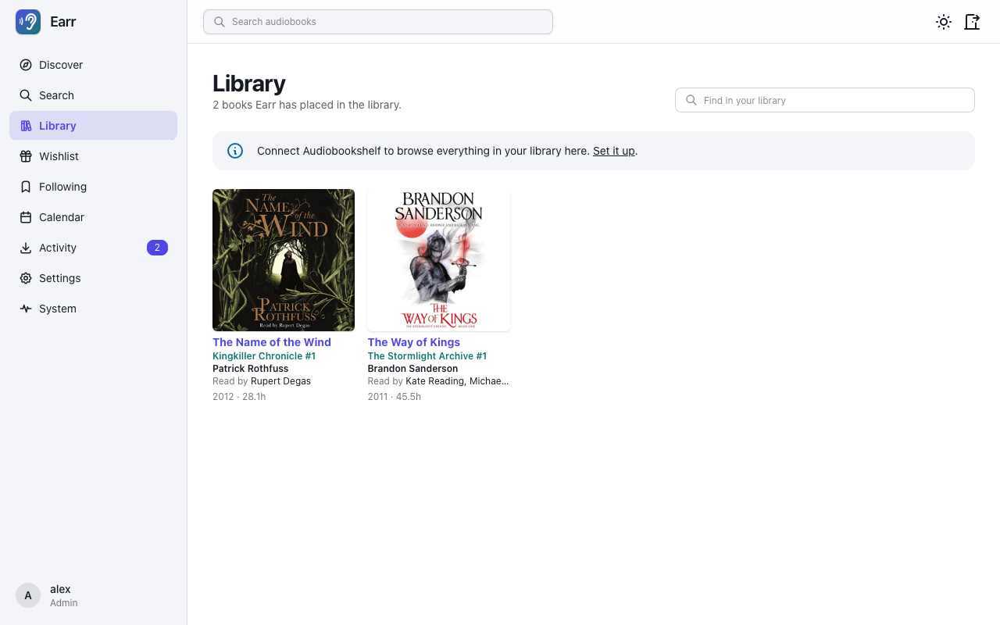
      </picture>
      <p align="center"><b>Library</b>: what's already on the shelf</p>
    </td>
    <td width="50%">
      <picture>
        <source media="(prefers-color-scheme: dark)" srcset="media/screenshots/library-dark.png">
        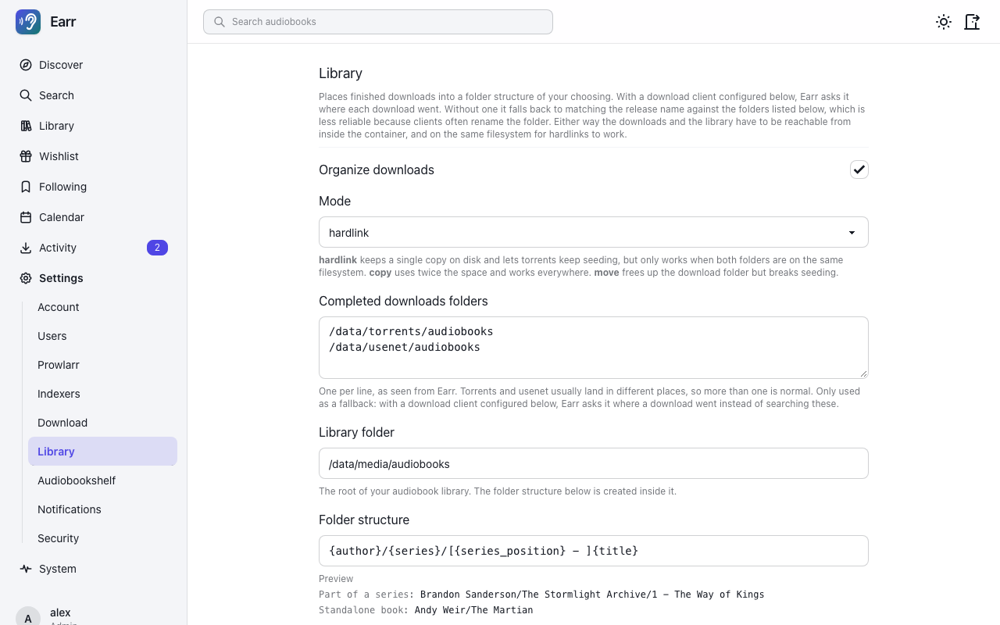
      </picture>
      <p align="center"><b>Library settings</b>: folder structure with a live preview</p>
    </td>
  </tr>
  <tr>
    <td width="50%" align="center">
      <picture>
        <source media="(prefers-color-scheme: dark)" srcset="media/screenshots/mobile-dark.png">
        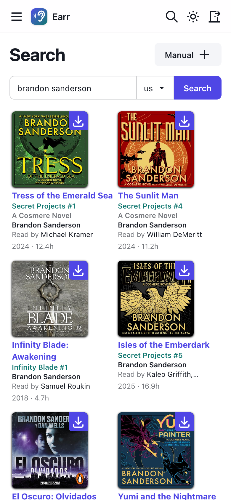
      </picture>
      <p align="center"><b>On your phone</b></p>
    </td>
  </tr>
</table>

## Features

**For everyone who requests books**

- Search Audible's catalogue by title, author or narrator, in any of Audible's 11 regions, with suggestions as you type.
- See the series and position, narrators, release year and length on every result, so you pick the right edition.
- Request with one click. Every result says whether it's already requested, downloading or in your library.
- Open any book for its description, the whole series in reading order with what you already have, and more by the
  author. Request the books you're missing from a series in one go.
- Follow an author or a series, and their new books are requested for you as soon as Audible lists them.
- Request a book before it's out. The Calendar shows what's coming, and it's searched for on its release day.
- Request books Audible doesn't sell, such as a LibriVox recording, with a manual request.
- Get recommendations based on what you've requested, see what's popular on your server, and browse what's trending.
- Follow your requests on the wishlist, and watch them download on the Activity page.
- Browse everything already in your library on the Library page.
- Use it on your phone, in a light or dark theme, or add it to your home screen like an app. Pages are rendered on the
  server, so it stays quick on a slow connection.

**For the admin**

- Three groups keep it simple: untrusted users' requests wait for you, trusted users' requests download straight away.
- Limit how many books each group, or each person, can request in a day, week or month.
- Let everyone sign in with their Audiobookshelf account, so there are no separate Earr accounts to create.
- Approve or decline what untrusted users ask for. An approved request downloads like a trusted user's; a declined
  one tells the requester why through your notifications.
- Prowlarr searches all your indexers and sends grabs to the download clients you already use, torrent or usenet.
- Automatic downloads only take a release that clears your quality bar: a bitrate range for each format, a minimum
  number of seeders, and a title or author match. If nothing clears it, nothing is grabbed.
- The Sources page ranks every release and shows which checks it passes or fails, so you can pick one yourself.
- Requests that haven't produced files are searched for again on a schedule, up to a number of attempts you set.
- A release that failed, or that you remove from the queue, is blocklisted and the next best one is grabbed instead.
- Releases that say they're in a language you don't want are never downloaded automatically.
- Finished downloads are filed into your library: hardlinked so torrents keep seeding, or copied or moved.
- qBittorrent, Transmission, Deluge, SABnzbd and NZBGet integration finds exactly where a grab landed, and can move
  it into a category or label.
- The Activity page shows each download's progress, speed and time left, the history of past downloads, and a manual
  import for downloads Earr couldn't match by itself.
- The System page checks every connection and folder, including whether hardlinks can work, and a light in the
  sidebar turns amber or red when something needs attention. It also takes daily database backups you can download
  or restore, and shows recent log lines.
- Audiobookshelf integration marks books you already own, adds each new book by scanning just its folder, and fills
  in metadata it's missing.
- Notifications to any webhook: Apprise, Gotify, Discord, ntfy and so on.
- Forms login, HTTP basic auth or OpenID Connect, plus API keys for scripts.
- SQLite out of the box, or Postgres.

**What it leaves to other tools**

Earr doesn't rename audio files, edit their tags, or split, join or re-encode them. The folder it files a book into
is named after the book, and everything inside is left as it was downloaded. Audiobookshelf reads the `metadata.json`
Earr writes, so messy file names still end up with the right details. For an all-in-one tool that also organizes
files, see [Listenarr](https://github.com/Listenarrs/Listenarr).

## Quick start

```bash
docker run -d --name earr -p 8000:8000 -v "$PWD/config:/config" ghcr.io/jedibrooker/earr:latest
```

Open http://localhost:8000. The first page asks you to create the root admin and choose how people log in. Everything
else is set up in the UI, and kept in `/config` along with the database.

With Docker Compose:

```yaml
services:
  earr:
    image: ghcr.io/jedibrooker/earr:latest
    container_name: earr
    restart: unless-stopped
    ports:
      - "8000:8000"
    environment:
      TZ: Etc/UTC
    volumes:
      - ./config:/config
      # only needed to organize the library: mount the folder your download
      # clients and your library live in, at the same path they use
      - /data:/data
```

The `/data` mount is only needed for [organizing the library](#organizing-the-library). For hardlinks to work, the
downloads and the library have to be on one filesystem, mounted as one volume, at the same path in every container.
[docs/DEPLOYMENT.md](docs/DEPLOYMENT.md) walks through a full setup.

Images are tagged `latest` on every push to `main`, and `sha-<commit>` so you can pin a build or roll back. Tagged
releases also get version tags. To update:

```bash
docker compose pull
```

```bash
docker compose up -d
```

## Setup

### Users and groups

| Group | Can |
| --- | --- |
| Untrusted | Search, request books and follow their requests. Their requests wait until an admin approves them or starts a download. |
| Trusted | The same, but their requests download automatically when **Auto Download** is on, and they can start an automatic download from the wishlist. |
| Admin | Everything: approving and declining requests, the Sources page, marking books as downloaded, users and settings. |

Create accounts under `Settings > Users`. The root admin is the account made on first start. Set
`EARR_APP__INIT_ROOT_USERNAME` and `EARR_APP__INIT_ROOT_PASSWORD` to create it without the setup page.

#### Approving requests

A request that only untrusted users made is marked **awaiting approval** on the wishlist. An admin can:

- **Approve** it. It then counts as a trusted user's request: it downloads straight away when **Auto Download** is on,
  and is searched for again later if nothing clears the bar yet. Earr sends `onRequestApproved`.
- **Decline** it, with an optional reason. The request is removed for everyone who asked, and `onRequestDeclined` is
  sent with the reason in `{declineReason}`, so whoever asked can be told why.

Both work over the API too: `POST /api/requests/{asin_or_uuid}/approve`, and
`POST /api/requests/{asin_or_uuid}/decline` with `{"reason": "..."}`.

#### Request limits

Under `Settings > Users`, **Request limits** caps how many books untrusted and trusted users can request per day,
week or month. 0 means no limit, which is the default, and admins are never limited. To give one person a different
limit, type it next to their name in the list; leave it empty to use their group's. Someone at their limit is told
when they can request again, and the book page shows how many requests they have left. Books requested because
someone follows an author or series don't count.

### Following authors and series

Open a book and choose **Follow author** or **Follow series**, or search for one under **Following** in the sidebar.
Earr checks Audible twice a day, and requests each new book for you as soon as it's listed, in your name: an
untrusted user's still waits for approval. **Check now** looks straight away.

What counts as new:

- Books already out when you follow are left alone. Announced books that aren't out yet are requested straight away.
- Only books in your preferred languages (see [Languages](#languages)), and not abridged editions or full-cast
  adaptations split into parts.
- A book you already have or asked for under another edition isn't requested again.

To catch up on a series you started late, open any book in it and use **Request N missing**, which requests every book
in the series that nobody has asked for and isn't in the library.

#### Pre-orders and the calendar

A book that isn't out yet can be requested like any other: its button says **Pre-order**. Nothing is searched for until
its release day, when Earr looks for it once an hour until a release is found, even if **Keep searching for outstanding
requests** is off. Regular re-searching takes over from there.

**Calendar** in the sidebar lists requested books by release date: what's coming up, and what came out in the last 30
days. Admins see everyone's, everyone else their own.

### Prowlarr and automatic downloads

1. In Prowlarr, copy the API key from `Settings > General`.
2. In Earr, open `Settings > Prowlarr` and enter the **API Key** and the **Base URL**, for example
   `http://prowlarr:9696`. Pick the **Categories** to search (Audio/Audiobook, `3030`, by default) and, optionally,
   limit the search to some **Indexers**.
3. Open `Settings > Download`:
   - **Auto Download** starts a download as soon as a trusted user or an admin requests a book.
   - The bitrate range for each format (flac, m4b, mp3, unknown audio, unknown) decides which releases are acceptable.
   - **Min Seeders** applies to torrents.
   - **Author/Narrator Similarity Ratio** and **Title Similarity Ratio** decide how closely a release name has to match.
   - Indexer flags with a score move releases up or down, for example `freeleech` with a score of 5.
   - **Keep searching for outstanding requests** searches again for requests that haven't produced files, including
     grabs that stalled. It only covers requests from trusted users and admins, runs every **Retry every** seconds
     (6 hours by default), and stops after **Give up after** attempts.
   - **Languages** are the languages you want books in. See [Languages](#languages).
4. MyAnonamouse users can add their session ID under `Settings > Indexers`. Earr then reads authors, narrators, file
   type and freeleech status from MyAnonamouse, which makes matching more accurate.

A release is only downloaded automatically when it is in the bitrate range for its format, has enough seeders,
matches the title or at least one author or narrator, isn't blocklisted, and isn't in a language you don't want. When
nothing qualifies, nothing is grabbed and the book stays on the wishlist for you to look at.

#### Languages

Audible lists every edition it sells, so the US store has Spanish and German editions too, and an indexer can have a
translation whose title matches. Under `Settings > Download`, tick the languages you want; it starts as the language of
your Audible region.

- A release whose name says it's in another language, such as `[GER]`, `Deutsch` or `(Spanish)`, is never downloaded
  automatically. One that doesn't say is given the benefit of the doubt.
- A book you deliberately request in another language is downloaded in that language.
- Following an author only requests books in your languages, and book pages leave other languages out of the series
  and "more by" lists.

#### How sources are ranked

The Sources page, opened from a request on the wishlist, shows every release Prowlarr found, best first. Releases are
compared on, in order:

1. whether they clear the settings above
2. title match
3. how many of the authors they name
4. how many of the narrators they name
5. format, in the order flac, m4b, mp3, unknown audio, unknown
6. indexer flag scores
7. indexer priority
8. subtitle match
9. seeders
10. age: older torrents and newer usenet posts first

Each release shows a **meets settings** or **fails settings** badge, followed by its checks: whether it's blocklisted,
its language when the name gives one, the title match, authors, narrators, format and bitrate, seeders and any scored
flags. A red ✗ is the reason a release is never downloaded
automatically. A grey ✗ only lowers its rank. Hover over a check for details. You can still send any release to the
download client by hand.

The bitrate is an estimate: the size of the whole release divided by the book's length. Extras such as PDFs or cover
art make it look higher than it is. The format is read from the release name.

### Download clients

Without a download client configured, Earr finds a finished download by matching the release name against the folders
in your completed downloads folder. That fails when the client renames the folder. Under
`Settings > Library > Download clients` you can add:

- **qBittorrent**: URL, username and password. Torrents are looked up by their info hash, so the match is exact.
- **Transmission**: URL, and username and password if RPC authentication is on. Looked up by info hash.
- **Deluge**: the Web UI's URL and password. Earr connects the Web UI to its daemon if it isn't already. Looked up by
  info hash.
- **SABnzbd**: URL and API key. Jobs are matched by name in the queue and history.
- **NZBGet**: URL, username and password. Matched by name, like SABnzbd.

Turn on the ones Prowlarr sends grabs to. Pick a **category** for each client to move Earr's grabs into. Prowlarr
chooses the category when it sends a release and can't be told otherwise, so Earr changes it afterwards. The category
has to exist in the client already, because its save path is what makes it useful: in qBittorrent with Automatic
Torrent Management on, changing the category moves the files. Transmission and Deluge have labels instead (Deluge needs
its Label plugin), which sort the downloads but don't move them, and SABnzbd and NZBGet can only recategorise a job
that's still in the queue. **Test connection** checks every client that's turned on.

### Organizing the library

Under `Settings > Library`:

- **Organize downloads** turns it on.
- **Mode**: `hardlink` keeps one copy on disk and lets torrents keep seeding, but needs the downloads and the library on
  the same filesystem. `copy` works everywhere but uses twice the space. `move` frees the download folder but stops
  seeding.
- **Completed downloads folders**: where your clients put finished downloads, one per line, as Earr sees them. With a
  download client configured, these are only a fallback.
- **Library folder**: the root of your audiobook library.
- **Folder structure**: a template for the folder each book goes into. The page previews it as you type.
- **Scan interval** and **Match threshold**: how often Earr looks for finished downloads, and how closely a folder
  name has to match the release when there's no client to ask.
- **Write metadata.json** (on by default) writes the title, subtitle, authors, narrators, series and ASIN for
  Audiobookshelf.
- **Overwrite existing files** (off by default) lets a new download replace files already in the library, including an
  existing `metadata.json`.

Placeholders you can use in the folder structure:

<!-- BEGIN GENERATED: placeholders -->

| Placeholder | Value |
| --- | --- |
| `{author}` | First author |
| `{authors}` | All authors, comma separated |
| `{title}` | Book title |
| `{subtitle}` | Book subtitle |
| `{series}` | Series name, empty if the book is standalone |
| `{series_position}` | Position within the series, e.g. 1 or 2.5 |
| `{narrator}` | First narrator |
| `{narrators}` | All narrators, comma separated |
| `{year}` | Release year |
| `{asin}` | Audible ASIN, or the request id for manual requests |

<!-- END GENERATED: placeholders -->

Two rules keep templates short:

- A folder that would be empty is left out, so `{author}/{series}/{title}` becomes `Andy Weir/The Martian` for a book
  that isn't part of a series.
- Text in square brackets disappears when a placeholder inside it is empty, so `[{series_position} - ]{title}` is
  just the title for a standalone book. A `|` inside the brackets adds a fallback:
  `[{series} #{series_position}|{title}]` uses the series for a series book and the title otherwise.

<!-- BEGIN GENERATED: template-examples -->

| Template | Part of a series | Standalone book |
| --- | --- | --- |
| `{author}/{title}` | `Brandon Sanderson/The Way of Kings` | `Andy Weir/The Martian` |
| `{author}/{series}/{title}` | `Brandon Sanderson/The Stormlight Archive/The Way of Kings` | `Andy Weir/The Martian` |
| `{author}/{series}/[{series_position} - ]{title}` | `Brandon Sanderson/The Stormlight Archive/1 - The Way of Kings` | `Andy Weir/The Martian` |
| `{author}/[{series} #{series_position}\|{title}]` | `Brandon Sanderson/The Stormlight Archive #1` | `Andy Weir/The Martian` |
| `{author}/{title} ({year})` | `Brandon Sanderson/The Way of Kings (2010)` | `Andy Weir/The Martian (2013)` |
| `{series}/{author} - {title}` | `The Stormlight Archive/Brandon Sanderson - The Way of Kings` | `Andy Weir - The Martian` |

<!-- END GENERATED: template-examples -->

Audible doesn't always say which series a book belongs to, and the position is read from the subtitle, so it can be
missing. Manual requests never have a series.

A download is only organized once it has stopped changing and has no partial files left. **Recent downloads** at the
bottom of the page shows each grab: waiting, organized, failed, or not found when it never showed up within 14 days.
The Activity page follows them more closely, see [Following downloads](#following-downloads).

### Following downloads

**Activity** in the sidebar has four tabs:

- **Queue**: every grab on its way to the library. With a download client set up it shows progress, size, speed and
  time left, refreshed every few seconds. Without one, each grab waits for its files to appear in the completed
  downloads folder. Earr keeps track of grabs while library organizing is on, so the queue stays empty when it's off.
  Admins can **Remove** a download, which deletes it and its files from the client, or **Blocklist** it, which also
  makes sure that release is never grabbed again and looks for another one straight away.
- **History**: downloads that reached the library, failed, or never showed up.
- **Blocklist** (admins only): releases that won't be grabbed again. A release lands here when the download client
  reports it as failed, or when you remove it with blocklist. Automatic downloads and re-searches skip it and take the
  next best release; the Sources page marks it, and you can still pick it by hand. **Allow again** takes it off.
- **Manual import** (admins only): folders in the completed downloads folders that haven't been imported, usually
  because the download client renamed them. Earr preselects the request each one most likely belongs to. **Import**
  files it into the library like any other download, marks the book as in the library and sends
  `onSuccessfulDownload`.

Anyone who isn't an admin sees only the downloads for books they asked for. The number next to Activity in the sidebar
is how many downloads are still on their way.

The same import works over the API:

```bash
curl -X POST http://localhost:8000/api/library/import \
  -H "Authorization: Bearer $EARR_API_KEY" \
  -H "Content-Type: application/json" \
  -d '{"asin_or_uuid": "B003ZWFO1X", "source_path": "/data/torrents/audiobooks/03 Way of Kings"}'
```

`asin_or_uuid` is the book's ASIN, or the id of a manual request. `source_path` has to be inside one of the completed
downloads folders: give it as an absolute path, or relative to those folders.

### Audiobookshelf

1. In Audiobookshelf, create an API token for an account that can see your audiobook library. An admin account is
   simplest.
2. In Earr, open `Settings > Audiobookshelf` and enter the **API Token** and the **Base URL**, for example
   `http://audiobookshelf:13378`, then pick the **Library**.
3. Turn on **Use ABS to mark existing books as downloaded** to have search results show books you already own.

Earr matches books by ASIN, or by title and first author when the ASIN is missing, so a book with sparse metadata in
Audiobookshelf can be missed.

When Earr files a book into the library, it tells Audiobookshelf about that one new folder instead of scanning the
whole library, waits for the book to appear, and fills in whichever of the subtitle, narrators, series, ASIN and year
Audiobookshelf left empty. Anything already set, including your own edits, is left alone. This needs Audiobookshelf
2.5 or later with its folder watcher on, and the library folder mounted at the same path in both containers; otherwise
Earr falls back to scanning the whole library. Starting a download, or marking a book as downloaded by hand, still
asks for a full scan while **Use ABS to mark existing books as downloaded** is on.

**Library** in the sidebar shows everything in the selected Audiobookshelf library, newest first, with a search box,
and opens a book in Audiobookshelf when you click it. Covers are fetched through Earr, so your browser never needs to
reach Audiobookshelf directly. Without Audiobookshelf connected, the page lists the books Earr itself has placed in
the library.

### System: status, backups and logs

**System** in the sidebar (admins only) has three tabs.

**Status** checks everything Earr depends on: whether Prowlarr answers and has indexers
enabled, whether each download client and Audiobookshelf can be reached with the details you entered, whether the
library folders exist and can be written to, and whether hardlinks can work between them. It also flags downloads
that have waited more than a day and requests that failed. Each problem links to the page that fixes it, and the dot
next to System turns amber or red when something needs attention. Results are reused for a minute; **Check again**
runs the checks straight away.

**Backups** copies the SQLite database, which holds every setting, user, request and follow. A backup is taken every
day and the last 7 are kept (both adjustable); **Back up now** takes one by hand, and those are kept until you delete
them. Backups are stored in `backups/` in the config folder and can be downloaded. **Restore** replaces everything with
a backup, after first taking a backup of the current state so the restore can be undone; a backup from an older
version of Earr is upgraded as it's restored. You can also upload a backup taken elsewhere. With Postgres, use
`pg_dump` instead.

**Logs** shows the most recent 2,000 log lines, newest first, filtered by level or text and refreshed live, with a
**Download** button for the lot. They're kept in memory, so a restart clears them, and debug lines are only kept when
`EARR_APP__LOG_LEVEL` is `DEBUG`.

### Notifications

Under `Settings > Notifications`, add a webhook: a **Name**, the **Event** that sends it, the **Notification URL**, a
**Body Type** of `text` or `json`, the **Body**, and optional **Headers** as JSON. That covers Apprise, Gotify,
Discord, ntfy and most other services. Each notification can be tested from the list.

For example, a Discord webhook with a `json` body:

```json
{"content": "{eventUser} requested {bookTitle} by {bookAuthors}"}
```

Events:

<!-- BEGIN GENERATED: notification-events -->

| Event | Sent when |
| --- | --- |
| `onNewRequest` | Someone requested a book. |
| `onGrabbed` | A source was sent to the download client. |
| `onSuccessfulDownload` | The files are in the library. With the library organizer on, this waits until they have been placed; otherwise it fires right after the grab. Also sent when an admin marks a book as downloaded. |
| `onFailedDownload` | Prowlarr could not start the download. |
| `onRequestApproved` | An admin approved a request from someone whose requests need approval. |
| `onRequestDeclined` | An admin declined a request. `{declineReason}` holds the reason they gave. |

<!-- END GENERATED: notification-events -->

Variables you can use in the body. Not every event has every variable; one that doesn't apply is left as written.

<!-- BEGIN GENERATED: notification-variables -->

| Variable | Value |
| --- | --- |
| `{declineReason}` | The reason an admin gave for declining a request |
| `{eventType}` | Name of the event, e.g. onNewRequest |
| `{eventUser}` | First user who requested the book |
| `{eventUserExtraData}` | That user's extra data, set under Settings > Users |
| `{joinedUsers}` | Everyone who requested the book, comma separated |
| `{joinedUsersExtraData}` | Their extra data, comma separated |
| `{bookTitle}` | Book title |
| `{bookAuthors}` | Authors, separated by commas |
| `{bookNarrators}` | Narrators, separated by commas |
| `{bookCover}` | Cover image URL, or a placeholder image when there is none |
| `{bookASIN}` | Audible ASIN |
| `{sourceTitle}` | Name of the release that was grabbed |
| `{sourceSizeMB}` | Size of that release in MB |
| `{sourceProtocol}` | torrent or usenet |
| `{indexerName}` | Indexer the release came from |
| `{torrentInfoHash}` | Info hash, for torrents |
| `{targetPath}` | Folder the book was organized into |
| `{errorStatus}` | HTTP status Prowlarr answered with |
| `{errorReason}` | Reason Prowlarr gave |

<!-- END GENERATED: notification-variables -->

### Login and OpenID Connect

Pick the login type under `Settings > Security`:

- **Forms**: a login page and a session cookie.
- **Basic**: the browser's own login dialog.
- **OpenID Connect**: log in with your identity provider, such as Authentik, Authelia or Keycloak.
- **None**: no login at all; everyone is the root admin. Only use this behind your own authentication.

`EARR_APP__FORCE_LOGIN_TYPE` pins the login type so it can't be changed in the UI.

To set up OpenID Connect, create a client with your provider using the redirect URI `https://<your-host>/auth/oidc`
(with your base URL in front of `/auth` if Earr runs under a sub path). Then fill in the client ID and secret, the
provider's `.well-known/openid-configuration` URL, the scopes, and the username claim. Users are created the first
time they log in.

- **Group claim**: a claim listing the user's groups, as a list or a space-separated string. A group named `admin`,
  `trusted` or `untrusted` sets the user's group on every login. The root admin's group is never changed.
- **Redirect scheme**: `auto` works out `http` or `https` from the request, which needs
  `EARR_APP__FORWARDED_ALLOW_IPS` set when Earr is behind a reverse proxy. Set `https` or `http` to force one.

If a change on the provider's side locks you out, go to `/login?backup=1` and log in with the root admin's username
and password to fix the settings.

#### Signing in with Audiobookshelf

With Audiobookshelf connected and the login type set to Forms or Basic, turn on **Sign in with Audiobookshelf** under
`Settings > Security`. Anyone with an Audiobookshelf account can then sign in with that username and password, and
their first sign-in creates their Earr account in the group you choose. Audiobookshelf admins can be made Earr admins
too. The password is checked with Audiobookshelf at every sign-in (and every 15 minutes with Basic auth), so a changed
password or a disabled account there stops working here as well. Accounts that only exist in Earr carry on as before
and are never checked against Audiobookshelf.

### Reverse proxy

- To serve Earr under a sub path such as `https://example.com/earr`, set `EARR_APP__BASE_URL=/earr`.
- Set `EARR_APP__FORWARDED_ALLOW_IPS` to your proxy's IP address so Earr trusts its `X-Forwarded-*` headers. The
  default only trusts `127.0.0.1`.

### Environment variables

Most settings live in the UI. These are read from the environment:

<!-- BEGIN GENERATED: env -->

| Variable | Default | Description |
| --- | --- | --- |
| `EARR_APP__DEBUG` | `false` | Development mode: detailed error pages, no caching of static files, and missing frontend scripts are downloaded at startup. |
| `EARR_APP__OPENAPI_ENABLED` | `false` | Serves the interactive API docs at /docs and the schema at /openapi.json. |
| `EARR_APP__CONFIG_DIR` | `/config` | Where the database and other state are kept. |
| `EARR_APP__PORT` | `8000` | Port the Docker image listens on. |
| `EARR_APP__VERSION` | `local` | Version shown in the UI. Set by the image build. |
| `EARR_APP__LOG_LEVEL` | `INFO` | Log level, e.g. DEBUG, INFO or WARNING. |
| `EARR_APP__BASE_URL` |  | Path prefix when served from a sub path behind a reverse proxy, e.g. /earr. |
| `EARR_APP__DISABLE_CENSOR` | `false` | Log usernames in full instead of partly masked. |
| `EARR_APP__FORWARDED_ALLOW_IPS` | `127.0.0.1` | Trusted proxy IPs for forwarded headers. Used by Uvicorn's --forwarded-allow-ips. |
| `EARR_APP__DEFAULT_REGION` | `us` | Default region used in the search |
| `EARR_APP__FORCE_LOGIN_TYPE` |  | Forces the login type used. If set, the login type cannot be changed in the UI. |
| `EARR_APP__INIT_ROOT_USERNAME` |  | Creates this root admin on first start instead of showing the setup page. Needs EARR_APP__INIT_ROOT_PASSWORD too. |
| `EARR_APP__INIT_ROOT_PASSWORD` |  | Password for the root admin created from EARR_APP__INIT_ROOT_USERNAME. |
| `EARR_DB__SQLITE_PATH` | `db.sqlite` | Relative path to the sqlite database given the config directory. If absolute, it ignores the config dir location. |
| `EARR_DB__USE_POSTGRES` | `false` | Use Postgres instead of SQLite. The postgres_* settings only apply when this is on. |
| `EARR_DB__POSTGRES_HOST` | `localhost` | Postgres host name. |
| `EARR_DB__POSTGRES_PORT` | `5432` | Postgres port. |
| `EARR_DB__POSTGRES_DB` | `earr` | Postgres database name. |
| `EARR_DB__POSTGRES_USER` | `earr` | Postgres user. |
| `EARR_DB__POSTGRES_PASSWORD` | `password` | Postgres password. |
| `EARR_DB__POSTGRES_SSL_MODE` | `prefer` | Postgres sslmode, e.g. disable, prefer or require. |

<!-- END GENERATED: env -->

### API

Everything the UI does is also available under `/api`. Create a key under `Settings > Account > API Keys` and send it
as a bearer token:

```bash
curl -H "Authorization: Bearer $EARR_API_KEY" "http://localhost:8000/api/search?q=project%20hail%20mary"
```

Set `EARR_APP__OPENAPI_ENABLED=true` to browse the endpoints at `/docs`.

## Development

The project uses [uv](https://docs.astral.sh/uv/) and [just](https://just.systems). The devcontainer has everything
installed, or install them with [mise](https://mise.jdx.dev): `mise install`.

```bash
uv sync
```

```bash
just install_daisy
```

```bash
just dev
```

`just dev` runs the migrations and starts the app on http://localhost:8000 with the settings in `.env.local`. Run
`just tailwind` alongside it to rebuild the CSS as you edit templates. The `docker-compose.yml` in the repository
starts Postgres and Gotify for testing those integrations.

Checks, which CI also runs:

```bash
just test          # pytest
just types         # basedpyright
just test_format   # djlint + ruff
just test_jinja    # jinjax template parameters
```

The tests use an in-memory SQLite database and real temporary folders, so file operations are tested for real.
Migrations are checked against SQLite and Postgres in CI.

Read [CONTRIBUTING](.github/CONTRIBUTING.md) before opening a pull request. Commits follow
[Conventional Commits](https://www.conventionalcommits.org).

### This README

Parts of this README are generated, so they can't drift from the code:

- The tables between `<!-- BEGIN GENERATED -->` and `<!-- END GENERATED -->` markers are built from the code:
  environment variables and their docstrings in `app/internal/env_settings.py`, the folder structure placeholders and
  examples, and the notification events and variables. Edit the code, not the table.
- The screenshots and `media/feature.png` are taken from a demo instance with books from Audible and a stand-in
  Prowlarr and qBittorrent. The feature graphic's layout lives in `media/brand/feature.html`. `media/logo.png` is rendered from the
  app's own icon, `static/favicon.svg`, which `just icons` draws from `scripts/icons.py` along with every other icon
  size.

The [README workflow](.github/workflows/readme.yaml) runs on every push to `main` that touches the app. It rebuilds the
tables, retakes the screenshots when templates, styles or `media/brand/` changed, and commits the result. With an
`ANTHROPIC_API_KEY` or `CLAUDE_CODE_OAUTH_TOKEN` repository secret, Claude also updates the prose for user-visible
changes, following [scripts/readme/prose.md](scripts/readme/prose.md). It can also be run by hand from the Actions tab.

To do the same locally (screenshots need a network connection for Audible):

```bash
just readme tables
```

```bash
just readme images
```

## Credits and license

Earr is a fork of [AudioBookRequest](https://github.com/markbeep/AudioBookRequest) by Markbeep and its contributors,
and like it is licensed under the [GPL-3.0](LICENSE).

It builds on [Prowlarr](https://github.com/Prowlarr/Prowlarr), which does the heavy lifting of searching indexers and
talking to download clients, and on Audible's
[public catalogue API](https://audible.readthedocs.io/en/latest/misc/external_api.html). Earr isn't affiliated with or
endorsed by Audible or Amazon.
